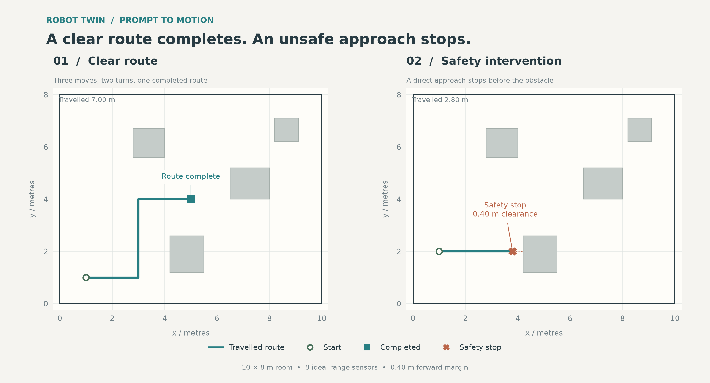
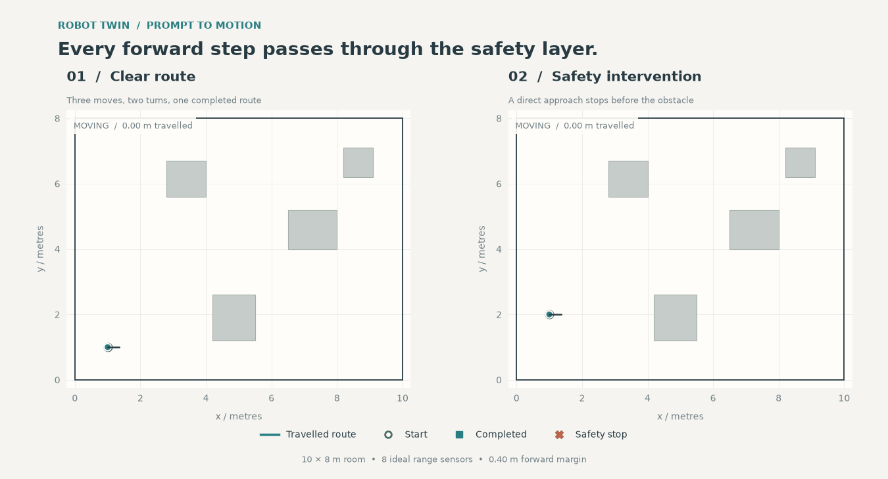

# Tiny Robot Twin

Write a command. Inspect the motion. See the safety policy intervene.

This is a small Python prototype inspired by the idea of twinning, training,
and commanding a robot as easily as writing a prompt. It implements a simulated
twin and a command interface. It does not train a model or connect to hardware.

I build robotics learning experiences and care about making technical tools
easy to inspect and use. I am still building depth in robotics mathematics.
This project keeps the model explicit: simple geometry, deterministic commands,
and a safety decision you can trace from a sensor reading to a stopped robot.

## Quickstart

Use Python 3.10 or newer. Save the seven files with the paths shown, open a
terminal in the project root, and run these six lines:

```bash
python -m venv .venv
source .venv/bin/activate
python -m pip install -r requirements.txt
python tests/test_twin.py
python src/run_demo.py
python -m pytest -q
```

On Windows PowerShell, replace the second line with
`.venv\Scripts\Activate.ps1`.

Setup and execution should take under five minutes on a typical laptop with
Python installed and an internet connection for dependencies. GIF rendering
is the slowest step.

The demo prints measured distances, final poses, and safety events. It writes:

- `results/trajectory.png`: a high-resolution comparison of both scenarios.
- `results/demo.gif`: the same scenarios animated side by side.

The results directory is created automatically. Running the demo again replaces
these two outputs. No display server, API key, model download, or external
simulation engine is required.

## Command a twin

```python
from src.twin import RobotTwin
from src.prompt_control import CommandError, execute_prompt

twin = RobotTwin()

try:
    result = execute_prompt(
        twin,
        "move forward 2 meters, turn left 90 degrees, "
        "move forward 1.5 meters",
    )
except CommandError as error:
    print(f"Command error: {error}")
else:
    print(result)
    print(twin.snapshot())
    print(twin.sense())
```

The prompt interface accepts three commands:

- `move forward NUMBER meters`
- `turn left NUMBER degrees`
- `turn right NUMBER degrees`

Separate commands with commas, `then`, or `, then`. Commands are
case-insensitive. Singular units, `metres`, `m`, and `deg` are also accepted.
Numbers must be finite, nonnegative decimals.

This is an explicit command grammar, not general language understanding.
Unsupported commands produce a readable `CommandError`. Catch that exception
at your application boundary, as shown above.

The entire prompt is validated before anything moves. A valid sequence stops
executing as soon as a movement command triggers safety. Later commands are
not executed automatically.

## World and coordinates

The default room is 10 metres wide and 8 metres high, with four rectangular
obstacles. The origin is the bottom-left corner.

Heading 0 faces right, along positive x. Heading 90 faces up, along positive y.
Left turns increase heading. Right turns decrease it. Headings wrap into
the interval [0, 360).

Eight ideal rays measure distance to the nearest obstacle or wall. Their
angles are relative to the robot: 0 is forward, 90 is left, 180 is backward,
and 270 is right.

The plotted robot marker is a visual symbol. The geometric robot is a point.

## What the safety layer does

Every forward move passes through `RobotTwin.move_forward()`, including moves
requested through the prompt interface.

Before the first step and every subsequent step, the robot checks its forward
sensor. A positive move is refused if the measured clearance is at or below
the 0.40 metre safety margin.

Otherwise, the next step is limited by all three of these quantities:

- The distance still requested.
- The configured step size, 0.05 metres by default.
- The measured clearance minus the safety margin.

This last limit prevents a large step from jumping through a thin obstacle.
If a move cannot finish, the robot stops, records a structured safety event,
and returns `completed=False`.

A move ending exactly at the allowed boundary can complete successfully.
A subsequent positive move toward that boundary is refused.

An initial position may be closer than the margin to a surface, provided it
does not touch the surface. Forward motion toward that surface is refused.
The policy does not create clearance that was missing at initialization.

Safety events include position, heading, forward clearance, requested distance,
travelled distance, and a readable explanation. Access them through
`twin.safety_events`. The demo also prints them.

This policy protects a point robot moving forward through a static, exact
world. It is not a hardware safety guarantee or an all-around clearance policy.

## Scenario results

Measured from an actual local run of `python src/run_demo.py` on
October 22, 2026 (Python 3.12, matplotlib Agg backend).

| Measurement | Scenario 1: clear route | Scenario 2: obstacle approach |
| --- | --- | --- |
| Intended behaviour | Complete all commands | Stop before the first obstacle |
| Completed | Yes | No (safety stop) |
| Distance travelled, m | 7.000 | 2.800 |
| Final position, m | (5.000, 4.000) | (3.800, 2.000) |
| Final heading, degrees | 0 | 0 |
| Safety events | 0 | 1 (stopped) |
| Forward clearance at safety stop, m | Not applicable | 0.400 |

Scenario 1 starts at (1, 1), travels east, north, then east again.

Scenario 2 starts at (1, 2) and requests seven metres east, directly toward a
box obstacle. The demo raises an error if this scenario fails to produce a
safety stop at the configured margin.





The GIF advances recorded simulation steps. It does not represent a measured
speed, control frequency, or hardware execution time.

## API summary

| API | Input | Output or effect |
| --- | --- | --- |
| `RobotTwin(...)` | Initial pose, room, obstacles, margin, step size | Validated twin |
| `twin.x`, `twin.y`, `twin.heading` | None | Read-only pose values |
| `move_forward(meters)` | Nonnegative distance | Movement result with completion status |
| `turn_left(degrees)` | Nonnegative angle | Updated state snapshot |
| `turn_right(degrees)` | Nonnegative angle | Updated state snapshot |
| `sense()` | None | Eight ranges keyed by relative angle |
| `snapshot()` | None | Independent state dictionary |
| `history` | None | Independent list of recorded poses |
| `safety_events` | None | Independent list of safety event dictionaries |
| `Box(x, y, width, height)` | Rectangle geometry | Immutable obstacle |
| `parse_commands(prompt)` | Supported English commands | Validated method/value pairs |
| `execute_prompt(twin, prompt)` | Twin and command string | Sequence result; aborts after safety stop |

Movement results contain `requested`, `travelled`, `completed`, and `reason`.
Snapshots contain position, heading, accumulated travel, and safety event count.
Snapshot dictionaries are JSON-compatible.

To use an empty room, pass `obstacles=()`. To use custom obstacles, pass a tuple
of `Box` instances.

## Tests

Run either `python tests/test_twin.py` or `python -m pytest -q`.

The tests cover turn wrapping, forward motion, wall sensing, immediate refusal,
stopping during a move, thin-obstacle tunnelling, diagonal sensing, prompt
validation, sequence abortion, the clear route, and independent snapshots.

The direct runner uses ordinary assertions. Do not run it with Python's `-O`
option, which disables assertions.

## Limitations

- Two dimensions and axis-aligned static obstacles.
- A point robot without a physical footprint.
- Perfect sensors with unlimited range and exact obstacle geometry.
- No communication or processing latency.
- No dynamics, acceleration, braking distance, inertia, or wheel slip.
- Instantaneous turns without swept-body collision checks.
- No localization uncertainty, moving obstacles, or sensor dropout.
- Forward-only clearance enforcement, not omnidirectional protection.
- No route planner, learned controller, training loop, or hardware adapter.
- Dependency ranges are provided, not an exact reproducibility lockfile.

## Next steps

1. Model the robot footprint and check its swept path.
2. Add noisy, delayed sensors and stale-reading rejection.
3. Introduce velocity, acceleration, and measured braking distance.
4. Separate simulation state from a hardware transport adapter.
5. Add a command watchdog and an independently accessible emergency stop.
6. Compare predicted and measured motion on a low-cost robot.

See `NOTES.md` for the first hardware experiments and the safety questions
that the simulation cannot answer.
